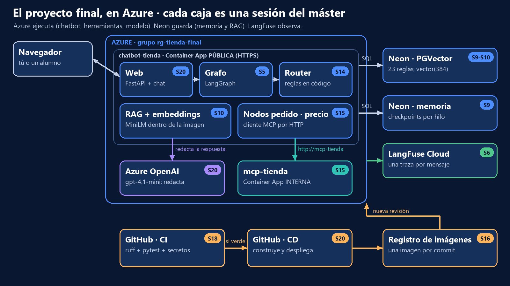

# Proyecto final · El asistente de la tienda, en producción

**Máster AI Engineer · Sesión 20.** Un chatbot web que atiende a los clientes de una tienda online: consulta pedidos, convierte precios, responde con los documentos de la tienda y recuerda cada conversación. Todo el máster junto en un solo proyecto, desplegado en **Azure** con **CI/CD**.



```
                 Navegador (tú, o cualquiera desde el móvil)
                         │  https://chatbot-tienda.<...>.azurecontainerapps.io
 ┌───────────────────────▼──────────────── AZURE ─────────────────────────────┐
 │  chatbot-tienda  (Container App, pública)                                   │
 │     web.py + agente LangGraph: router → pedido | precio | rag | charla      │
 │        │                       │                                            │
 │        ▼                       ▼                                            │
 │  Azure OpenAI           mcp-tienda  (Container App, INTERNA: solo la ve     │
 │  gpt-4.1-mini           el chatbot) · tools consultar_pedido y              │
 │                         convertir_precio                                    │
 └───────────┬───────────────────────────────────────────────┬────────────────┘
             ▼                                               ▼
     Neon (Postgres): memoria de cada                LangFuse Cloud:
     conversación + RAG con PGVector                 una traza por mensaje
```

| Pieza | Sesión | Dónde está |
|---|---|---|
| Grafo con estado, router y nodos | S5, S14 | `agente/agente.py`, `agente/router.py` |
| Memoria persistente (checkpointer en Postgres) | S9 | Neon |
| RAG con PGVector | S9, S10 | `agente/rag.py`, `agente/docs/` |
| Herramientas por MCP | S15 | `mcp/server.py` |
| Trazas | S6 | LangFuse |
| Tests, ruff, secretos, CI | S18 | `.github/workflows/ci.yml` |
| Contenedores y nube | S16 | `agente/Dockerfile`, `mcp/Dockerfile`, `azure/` |
| **CD: despliegue automático** | S20 | `.github/workflows/cd.yml` |

## Estructura

```
proyecto-final/
├── agente/                el chatbot
│   ├── agente.py          el grafo (router, nodos, memoria, trazas)
│   ├── web.py             la web: FastAPI + static/index.html
│   ├── router.py rag.py herramientas.py config.py
│   ├── docs/              los documentos de la tienda (el RAG)
│   ├── tests/             10 tests sin LLM, sin base de datos y sin red
│   └── Dockerfile
├── mcp/                   el servidor MCP de las herramientas
│   ├── server.py  tests/  Dockerfile
├── azure/
│   ├── desplegar.sh       crea TODO en Azure con un comando
│   ├── conectar_github.sh da permiso a GitHub Actions para desplegar (sin contraseñas)
│   └── apagar.sh          lo borra TODO
├── .github/workflows/
│   ├── ci.yml             en cada push: ruff + pytest de las dos piezas + secretos
│   └── cd.yml             si la CI sale verde: construye y despliega en Azure
└── .env.example           la plantilla de tus claves
```

## Paso 0 · Lo que necesitas

- Python 3.12 y VS Code.
- Una cuenta de **Neon** (S9) y una de **LangFuse Cloud** (S6), con sus claves.
- Una suscripción de **Azure** y la **Azure CLI** (`az login`), o la Cloud Shell del portal.
- Una cuenta de **GitHub**.

```bash
cp .env.example .env      # y rellena DATABASE_URL y las claves de LangFuse
```

## Paso 1 · En local

```bash
# Terminal 1: las herramientas
cd mcp
python -m venv .venv && .venv\Scripts\activate      # en Mac/Linux: source .venv/bin/activate
pip install -r requirements-dev.txt
set MCP_TRANSPORT=http && python server.py          # Mac/Linux: MCP_TRANSPORT=http python server.py

# Terminal 2: el chatbot
cd agente
python -m venv .venv && .venv\Scripts\activate
pip install -r requirements.txt
python rag.py --indexar                              # una vez: los documentos a Neon
uvicorn web:app --port 8080                          # abre http://localhost:8080
```

Sin `AZURE_OPENAI_ENDPOINT` en el `.env`, el modelo es **llama3.1 con Ollama** en tu portátil. Con él, es **Azure OpenAI**. El grafo es el mismo: solo cambia `config.crear_llm()`.

También funciona por terminal, como en clase: `python agente.py --hilo ana "Hola, soy Ana"`.

## Paso 2 · Todo a Azure, con un comando

```bash
az login
bash azure/desplegar.sh
```

El script, en este orden:
1. Crea el grupo de recursos `rg-tienda-final`.
2. Crea **Azure OpenAI** con el modelo `gpt-4.1-mini` (tope de 50.000 tokens/min).
3. Crea un **registro de imágenes** y construye las dos imágenes **en la nube**. No necesitas Docker.
4. Crea el **entorno de Container Apps** y dos apps:
   - `mcp-tienda` con **ingress interno**: desde internet no existe; el chatbot la llama por `http://mcp-tienda`.
   - `chatbot-tienda` con **ingress externo**: HTTPS público. Las claves van como **secretos** de la app, nunca dentro de la imagen.
5. Imprime la URL del chatbot.

Las dos apps **escalan a cero**: sin visitas no hay contenedor encendido, y la primera visita tarda ~1 minuto en despertarlo.

## Paso 3 · GitHub y la CI

Crea un repositorio **vacío** en github.com/new y súbelo (S18):

```bash
git init && git add . && git commit -m "Proyecto final"
git branch -M main
git remote add origin https://github.com/TU-USUARIO/proyecto-final.git
git push -u origin main
```

En **Settings → Secrets and variables → Actions**:
- Secrets `LANGFUSE_PUBLIC_KEY` y `LANGFUSE_SECRET_KEY`.
- Variable `LANGFUSE_HOST`.

Cada push lanza `ci.yml`.

## Paso 4 · La CD: push y se despliega solo

```bash
REPO=TU-USUARIO/proyecto-final bash azure/conectar_github.sh
```

Imprime tres valores. Guárdalos como Secrets del repositorio: `AZURE_CLIENT_ID`, `AZURE_TENANT_ID` y `AZURE_SUBSCRIPTION_ID`.

Desde ahí: **push → CI verde → `cd.yml` construye las imágenes con la etiqueta del commit → actualiza las dos apps → comprueba `/salud`**. Si la CI sale roja, no se despliega nada.

¿Por qué no hay contraseña de Azure en GitHub? Por **OIDC**: Azure confía en los tokens que GitHub firma para la rama `main` de *este* repositorio. Además, la identidad solo puede tocar el grupo `rg-tienda-final`.

## Paso 5 · Apagarlo

```bash
bash azure/apagar.sh
```

Borra el grupo de recursos entero y comprueba que no queda nada. El entorno de Container Apps tarda 20-30 minutos en borrarse. Neon y LangFuse siguen en sus capas gratuitas.

## Lo que cuesta (orientativo)

| Recurso | Coste |
|---|---|
| Container Apps (escalan a cero) | Céntimos por hora de uso real |
| Azure OpenAI `gpt-4.1-mini` | Céntimos por cientos de preguntas |
| Registro de imágenes (Basic) | El único fijo: unos pocos euros al mes. **Bórralo al terminar** |

## Si algo falla

| Síntoma | Causa típica |
|---|---|
| La primera pregunta da error o tarda | La app estaba en cero réplicas: espera un minuto y repite |
| `consultar_pedido` falla en Azure | `mcp-tienda` sin ingress o `MCP_URL` distinto de `http://mcp-tienda` |
| La CD falla en «Entrar en Azure» | Faltan los 3 Secrets de Azure o el repo no coincide con el de `conectar_github.sh` |
| La CI sale roja en `secretos` | Faltan los Secrets de LangFuse o la variable `LANGFUSE_HOST` |
